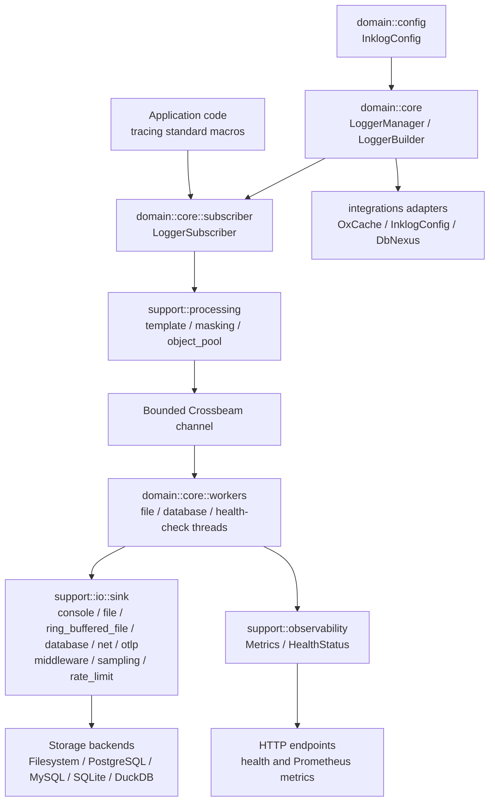
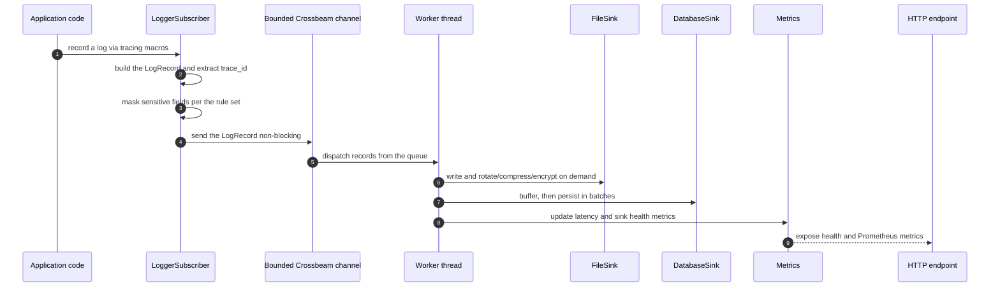
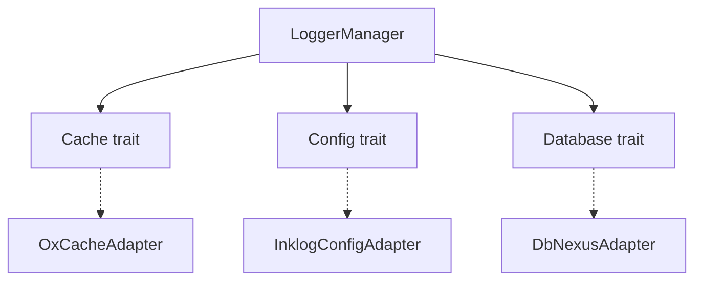
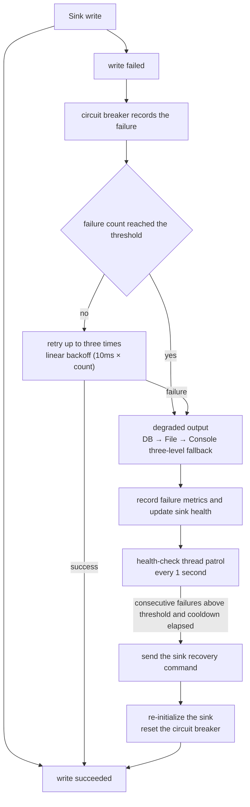

# 🏗️ inklog Architecture

This document describes inklog's overall architecture, design principles, core components, data flow, concurrency model, and extension points, helping users and contributors understand its internals. Usage-oriented content lives in the [📖 User Guide](USER_GUIDE.md); API details live in the [📘 API Reference](API_REFERENCE.md).

<details open>
<summary>📑 Contents</summary>

- [🧭 Overview](#-overview)
- [🗺️ Layered Architecture](#️-layered-architecture)
- [🔀 Core Pipeline](#-core-pipeline)
- [🧩 Core Components](#-core-components)
- [🔌 Dependency Injection Architecture](#-dependency-injection-architecture)
- [🚰 Sink System](#-sink-system)
- [🧵 Concurrency Model](#-concurrency-model)
- [💾 Storage Layer](#-storage-layer)
- [🔐 Security Architecture](#-security-architecture)
- [⚡ Performance Considerations](#-performance-considerations)
- [🧷 Extension Points](#-extension-points)
- [📦 Dependencies](#-dependencies)
- [🧱 Advanced Capability List](#-advanced-capability-list)

</details>

---

## 🧭 Overview

inklog is enterprise-grade Rust logging infrastructure designed for production. Application code uses the standard `log` / `tracing` macros while inklog takes over subscription, masking, dispatch, and persistence.

### Design Goals

| Goal | How it is achieved |
|------|----------|
| **High performance** | Bounded Crossbeam channels + a dedicated worker thread pool; non-blocking senders; template rendering ~320 ns/record (see the [⚡ Performance Baseline](PERFORMANCE.md)) |
| **Reliability** | Circuit breaker, DB → File → Console three-level fallback, automatic recovery via health checks, shutdown timeout protection |
| **Security** | AES-256-GCM encryption, automatic PII masking, key zeroization in memory, path and SQL injection protection |
| **Observability** | Prometheus metrics, health check endpoints, latency histograms |
| **Extensibility** | Custom outputs via the `LogSink` trait; `add_sink` registers dynamically with zero core changes |

## 🗺️ Layered Architecture

inklog uses a layered async architecture: the `domain` layer holds `LoggerManager` / `LoggerBuilder` and the configuration model; `domain::core::subscriber` implements the tracing Subscriber and builds `LogRecord`s; records pass through `support::processing` for template rendering and masking into a bounded Crossbeam channel, from which dedicated threads in `domain::core::workers` dispatch to the sinks in `support::io::sink`; the `integrations` layer adapts caching (oxcache), configuration (confers), and the database (dbnexus) onto the `Cache` / `Config` / `Database` traits via dependency inversion; `support::observability` aggregates health status and metrics and exposes endpoints via the `http` feature.



| Layer | Responsibility |
|------|------|
| `domain` | Logger manager, builder, DI container, Subscriber, worker threads, and the configuration model |
| `support` | Sink implementations, template and masking processing, object pool, metrics, validation, query, audit chain |
| `integrations` | Adapts oxcache / confers / dbnexus / trait-kit onto traits, isolating external dependencies |
| `i18n` | Fluent + ICU message localization (zh-CN / en resources under `locales/`) |
| `cli` | The `inklog-cli` binary: decrypt / generate / validate / query / verify-chain |

## 🔀 Core Pipeline

The full path of a log record from emission to persistence:



Key points:

- Senders only block when the channel is full (backpressure); defaults are capacity 10000 and 3 worker threads, tunable via `PerformanceConfig`;
- The file thread uses blocking I/O; the database thread owns an independent tokio runtime;
- Encryption, compression, and rotation fire per rotated file and never occupy the per-record write hot path.

## 🧩 Core Components

### LoggerManager

The central coordinator, responsible for initialization, operation, and lifecycle management of the logging system.

**Initialization flow**:

1. Validate the configuration (`InklogConfig::validate()`);
2. Create the Crossbeam channels (main and console channels default to capacity 10000; the control channel to 10);
3. Initialize ConsoleSink and LoggerSubscriber;
4. Start worker threads (file, database, health check, plus one dedicated thread per dynamic sink);
5. Install the global tracing subscriber and the `log` crate frontend (skipped with a fallback if already installed);
6. [Optional, `http` feature] start the HTTP health and metrics endpoints.

**Shutdown flow**: `shutdown()` uses a 2-second timeout send (`send_timeout`) for the stop signal and keeps polling worker handles after timeout, so it never hangs; it then drains the channels and shuts down all sinks.

### LoggerSubscriber

Implements `tracing::Subscriber`, layered on top of `tracing_subscriber::Registry`:

- Builds a `LogRecord` from each event (timestamp, level, target, message, structured fields, file/line, thread_id);
- Extracts `trace_id` / `span_id` (from the current tracing span; without OTel, derived as 32/16-bit hex along the parent chain from the root span id);
- Applies masking rules to messages and fields;
- Supports runtime level hot-reload via `EnvFilter` (wrapped in reload);
- Sends to the channel non-blocking, with backpressure when the queue is full;
- On rate limiting, enters the pressure path: the `SamplingPolicy` (`InklogConfig.sampling`, per_level rates + per_target_prefix rules, longest prefix first) decides first; on miss it falls back to the built-in default (drop non-critical levels, keep 1/100 of ERROR/FATAL); sampled-out records count into `inklog_sampled_out_total`.

### Configuration System (InklogConfig)

A centralized configuration struct supporting TOML file loading; `INKLOG_*` environment variable overrides apply when loading via `InklogConfig::load_with_env_overrides()` (`LoggerManager::new()` / `LoggerManager::load()` go through `load_sync()` and do not apply env overrides).

**Configuration precedence** (loading via `InklogConfig::load_with_env_overrides()`, highest to lowest):

1. Environment variables (`INKLOG_*`);
2. Configuration file (`inklog_config.toml`);
3. Defaults.

**Validation rules**:

- The log level must be valid (trace/debug/info/warn/error/fatal);
- The file path must not be empty;
- The database URL must not be empty;
- Enabling encryption requires a key environment variable name.

Field-by-field configuration reference: [📘 API Reference](API_REFERENCE.md).

## 🔌 Dependency Injection Architecture

inklog achieves module decoupling and testability through trait abstractions.



### Core Design Principles

1. **Dependency inversion (DIP)**: high-level modules (LoggerManager) depend on trait abstractions; low-level modules (adapters) implement the interfaces;
2. **Interface segregation (ISP)**: each trait has a single responsibility — Cache handles caching, Config handles configuration, Database handles storage;
3. **Dependency injection**: constructor injection (`LoggerDependencies`); all dependencies are `Option<Arc<dyn Trait>>`, with default adapters used when nothing is injected.

### Infrastructure Traits

| Trait | Responsibility | Production implementation | Test implementation |
|-------|------|----------|----------|
| `Cache` | Cache log metadata and config values (`get`/`set`/`delete`/`exists`, returning `Result`) | `OxCacheAdapter` (oxcache) | `MockCache` (`RwLock<HashMap>`, `test-utils`) |
| `Config` | Configuration access (`get_string`/`get_int`/`get_bool`/`get_float`) | `InklogConfigAdapter` (built-in) | `MockConfig` (`RwLock<HashMap>`, `test-utils`) |
| `Database` | Batched persistence (`insert_batch`/`is_healthy`) | `DbNexusAdapter` (dbnexus) | `MockDatabaseAdapter` (`RwLock<Vec<LogRecord>>`, `test-utils`) |

Trait signatures one by one: [📘 API Reference](API_REFERENCE.md), "Dependency Injection Types".

### Dependency Injection Usage Patterns

| Pattern | Usage | Scenario |
|------|------|------|
| Pure defaults | `LoggerManager::new().await?` | zero-dependency start |
| Configuration file | `LoggerManager::from_file("config.toml").await?` | production deployment |
| Dependency injection | `LoggerManager::with_dependencies(deps).await?` | tests and custom implementations |

### Design Advantages

- **Testability**: inject mocks to test in isolation, without starting a real cache/database;
- **Extensibility**: implement the corresponding trait to swap the underlying implementation (e.g. Redis cache, Consul config center, TimescaleDB);
- **Decoupling**: the core never depends on external library APIs directly; adapters isolate them (oxcache / confers / dbnexus / trait-kit).

### Configuration Key Mapping

`InklogConfigAdapter` supports the full dotted configuration key paths (`global.*` / `file_sink.*` / `console_sink.*`) so external configuration systems can align; the per-key list is in the [📘 API Reference](API_REFERENCE.md#config-trait).

## 🚰 Sink System

### The LogSink Abstraction

All output targets implement the unified `LogSink` interface (methods take `&self`; interior mutability is the implementer's responsibility); `AsyncSink` is its marker sub-trait (blanket impl) used for dynamic registration and trait-object upcasting. Trait signatures and the built-in implementation list: [📘 API Reference](API_REFERENCE.md#-sink-types).

### Built-in Sinks

| Sink | Feature | Highlights |
|------|---------|------|
| ConsoleSink | none | ANSI colors (ERROR=red / WARN=yellow / INFO=green / DEBUG=blue), stderr level routing (default error/warn), `NO_COLOR` / `TERM=dumb` detection |
| FileSink | compression/encryption by feature | rotation (size + time), Zstd/Gzip compression, AES-256-GCM encryption, circuit breaker, disk-space check and old-log cleanup |
| DatabaseSink | one of the four backends | raw-SQL batched persistence via dbnexus, connection pooling, partitioned tables, circuit breaker |
| ChannelBufferedFileSink | none | channel-buffered high-throughput file sink |
| TcpSink / UdpSink | `net-sink` | TCP (optional TLS, rustls) + UDP (NDJSON), disconnect buffering, half-open probing, automatic reconnect with in-order replay |
| OtlpSink | `otlp` | OTLP/HTTP JSON export (hand-written transport, zero new dependencies) |

### Decorators and Middleware

Decorators wrap any sink and run on the **per-sink thread**, never stacking onto the subscriber hot path:

| Decorator | Type | Notes |
|--------|------|------|
| `SamplingSink` + `Sampler` | sampling | level threshold + N-of-1 + keyword allowlist exemption; `should_emit` is an atomic counter |
| `RateLimitedSink` + `TokenBucketRateLimit` | rate limiting | object-safe `SinkRateLimit` port + `NoOpRateLimit` default; `try_acquire` is lock-free CAS (the kernel is the in-crate `BurstLimiter`: pure budget, no clock, no refill); the subscriber-level limiting kernel is the in-crate token bucket (capacity = rate, refilled at the rate per second); extensions go through the crate's own `SinkRateLimit` port — inklog depends on no external rate-limiting library |
| `MiddlewareSink` + `MiddlewareChain` | middleware | filter (`LevelFilterMiddleware`) / transform (`RecordMiddleware` / `EnrichMiddleware`) composition |

### Dynamic Sink Registration (add_sink)

Third-party sinks implementing `LogSink` register via `LoggerBuilder::add_sink(Arc<dyn AsyncSink>)` with zero core changes:

- Each dynamic sink gets its own bounded channel and a generic SinkWorker consumer thread, never preempting each other;
- At shutdown, each channel is drained as part of the global shutdown.

### Console Sink Workflow

```text
LogRecord
  ↓
Check whether this is an stderr level (default error / warn)
  ↓ [yes]            [no]
stderr             stdout
  ↓                  ↓
Apply colors       No color (or color disabled in Json format)
  ↓
Write to the terminal
```

### FileSink Write Flow

```text
LogRecord
  ↓
Check the circuit breaker state
  ↓ [open]            [closed]
Fall back to Console   Continue
                      ↓
Check disk space (keep the larger of the 50MB reserve and 10% free space; fall back to Console when short)
  ↓ [short]            [sufficient]
Fall back to Console   Continue
                      ↓
Write to BufWriter<File>
  ↓
Check rotation conditions (max_size / rotation_time)
  ↓ [rotate]           [no rotation]
Rotate: rename to {stem}_{YYYYMMDD_HHMMSS}{ext}
      → compress .zst → background encrypt .enc     Update file size
```

### DatabaseSink Workflow

Database operations run through dbnexus as **raw SQL (no ORM)**:

- **Table schema**: `timestamp`, `level`, `target`, `message`, `fields` (JSON text), `file`, `line`, `thread_id`; the `id` auto-increment primary key is generated only for the SQLite / PostgreSQL / MySQL branches (the DuckDB branch has no id column; row identity comes from the implicit rowid); DDL is generated per driver (SQLite `INTEGER PRIMARY KEY AUTOINCREMENT`, PostgreSQL `BIGSERIAL`, MySQL `BIGINT AUTO_INCREMENT`; DuckDB omits the auto-increment column because duckdb-rs reports `Constraint not implemented` for AUTOINCREMENT/IDENTITY);
- **Batch writes**: buffer until `batch_size` (default 100) or `flush_interval_ms` (default 500ms) triggers a batched INSERT; DuckDB uses parameter binding with prepared statements;
- **Dynamic batch size**: adapts to write success rate and average latency (doubles when success rate ≥ 0.95 and average latency < 50ms; halves when success rate < 0.8 or average latency > 200ms), decoupled from the circuit breaker state;
- **Partitioned tables**: partitions created per `PartitionStrategy` (Monthly / Yearly); table and partition names are whitelist-validated before being spliced into DDL (against SQL injection);
- **Archive export**: `archive_format` supports Json / Parquet (Arrow columnar, Zstd compressed) / Csv.

## 🧵 Concurrency Model

### Mixed Runtime Architecture

| Component | Runtime type | Purpose |
|------|------------|------|
| Application code | tokio (multi-threaded) | async logging APIs |
| LoggerSubscriber | tokio | non-blocking channel send |
| File thread | blocking (`spawn_blocking` OS thread) | file I/O and rotation |
| Database thread | blocking + independent tokio runtime | batched database operations |
| Health-check thread | blocking (`spawn_blocking` OS thread) | patrol every 1 second (unhealthy-sink rebuild cooldown 30 s, requiring more than 3 consecutive failures) |
| Dynamic sink threads | blocking (`spawn_blocking` OS thread, one per sink) | third-party sink consumption |

How the database thread builds its independent runtime:

```rust
let rt = tokio::runtime::Builder::new_multi_thread()
    .thread_name("inklog-db-worker")
    .enable_all()  // including I/O and timer drivers
    .build()?;
```

### Channel Topology

| Channel | Capacity | Purpose |
|------|------|------|
| Main log channel | `channel_capacity` (default 10000) | `Arc<LogRecord>` from subscriber to worker threads |
| Console channel | `channel_capacity` | console output only, isolated from the file/database paths |
| Control channel | 10 | `SinkControlMessage` (recovery commands etc.) from the health-check thread to worker threads |
| Dynamic sink channels | `channel_capacity` (one per sink) | independent consumption for third-party sinks |
| Stop channel | 1 | the `shutdown()` stop signal (2-second timeout send) |

```rust
let (sender, receiver) = bounded(capacity);           // main channel
let (console_sender, console_receiver) = bounded(capacity);
let (control_tx, control_rx) = bounded(10);           // control channel
```

**Queue behavior**:

- Bounded channels provide backpressure: when the queue is full, senders block, preventing memory exhaustion;
- Receivers use `recv_timeout` to wake periodically and flush;
- Channel usage level is exposed via Metrics; the `Adaptive` strategy scales the channel automatically by usage.

### Circuit Breaker

```rust
pub struct CircuitBreaker {
    state: CircuitState,      // Closed | Open | HalfOpen
    failure_count: u32,
    failure_threshold: u32,   // default 5
    reset_timeout: Duration,  // default 30 seconds
}
```

Reaching the failure threshold opens the breaker; after the cooldown it enters HalfOpen to probe; success returns it to Closed.

### Failure Fallback and Self-Healing



- **Three-level fallback**: when the database is unavailable, fall back to file; when file is unavailable, fall back to console;
- **Automatic recovery**: the health-check thread detects unhealthy sinks (consecutive failures above threshold and cooldown elapsed) and sends `SinkControlMessage::RecoverSink` to trigger a rebuild; the result is written back to metrics;
- **Manual recovery**: `recover_sink("file")` / `trigger_recovery_for_unhealthy_sinks()`.

## 💾 Storage Layer

### File Storage

**File organization**: for rotated archive naming and directory layout examples (timestamp format `%Y%m%d_%H%M%S`), see the [📖 User Guide](USER_GUIDE.md#rotated-file-naming).

**Rotation strategies**: reaching `max_size` rotates immediately; `hourly` / `daily` / `weekly` rotate on schedule; when a second rotation happens within the same second and the target already exists, a `.1`, `.2` numeric suffix is appended, guaranteeing nothing is ever overwritten.

**Compression algorithms**:

| Algorithm | Feature | Ratio | Speed |
|------|---------|--------|------|
| Zstd | `compression` | ~3.5x (default level 3) | fast |
| Gzip | `gzip` (FileSink falls back to gzip when compression is off) | ~2.5x | moderate |

### Database Storage

| Database | Feature | Highlights |
|--------|---------|------|
| PostgreSQL | `postgres` | partitioned tables, connection pool, rustls runtime |
| MySQL | `mysql` | partitioned tables, connection pool |
| SQLite | `sqlite` | single table (no partitions), embedded, zero deployment |
| DuckDB | `duckdb` | analytical, parameterized batch inserts (prepared statements) |

Database backends are mutually exclusive (dbnexus forbids mixing embedded and server-side drivers).

**Table schema** (PostgreSQL example; type mapping per driver as above):

```sql
CREATE TABLE IF NOT EXISTS logs (
    id BIGSERIAL PRIMARY KEY,
    timestamp TIMESTAMPTZ NOT NULL,
    level TEXT NOT NULL,
    target TEXT NOT NULL,
    message TEXT NOT NULL,
    fields TEXT,          -- structured fields (JSON text)
    file TEXT,
    line INTEGER,
    thread_id TEXT NOT NULL
);
```

**Partitioned table** (PostgreSQL, monthly):

```sql
CREATE TABLE IF NOT EXISTS logs_2026_09 PARTITION OF logs
FOR VALUES FROM ('2026-09-01') TO ('2026-10-01');
```

## 🔐 Security Architecture

For the full security design (key formats, masking rule set, reporting process, and compliance), see the [🔒 Security Documentation](SECURITY.md); the authoritative list mapping each security mechanism to its implementation location (architectural landing point) is the "[Security Capabilities Overview](SECURITY.md#️-security-design-overview)" table there, which is not repeated here; for the byte-level layout of the encrypted file format (v2 header structure and v1 / Legacy compatibility), see "[Encrypted File Format](SECURITY.md#encrypted-file-format)".

## ⚡ Performance Considerations

### Main-Path Cost

The write main path (template rendering) costs about 320 ns/record; official benchmarks and the test environment are in the [⚡ Performance Baseline](PERFORMANCE.md).

### Batching

| Strategy | Database transactions | Throughput (reference) |
|------|------------|------------------|
| Row-by-row insert | N (autocommit) | ~100 rows/s |
| Batch of 100 | single | ~10,000 rows/s |

Batch trigger: the buffer reaches `batch_size` (default 100) or more than `flush_interval_ms` (default 500ms) has passed since the last flush.

### Compression Strategy

| Level | Positioning | Ratio |
|------|------|--------|
| 0 | fastest | ~2.5x |
| 3 (default) | balanced | ~3.5x |
| 19 | maximum compression | ~4.5x, slow |

### Queue Management

- Bounded channels provide backpressure, preventing memory exhaustion;
- Channel usage is exposed via Metrics (Prometheus `inklog_channel_blocked_total` and more);
- The `Adaptive` channel strategy expands at `expand_threshold_percent` (default 80%) and shrinks at `shrink_threshold_percent` (default 20%), waiting `shrink_wait_seconds` (default 30 seconds) before shrinking.

## 🧷 Extension Points

### Custom Sink (dynamic registration, recommended)

Implement the `LogSink` trait and register via `add_sink` with zero core changes:

```rust
use async_trait::async_trait;
use inklog::{AsyncSink, LogRecord, LoggerBuilder, LogSink};
use std::sync::Arc;

pub struct SlackSink {
    webhook_url: String,
    buffer: std::sync::Mutex<Vec<LogRecord>>,
}

#[async_trait]
impl LogSink for SlackSink {
    async fn write(&self, record: &LogRecord) -> Result<(), inklog::InklogError> {
        self.buffer.lock().unwrap().push(record.clone());
        if self.buffer.lock().unwrap().len() >= 10 {
            self.flush().await?;
        }
        Ok(())
    }

    async fn flush(&self) -> Result<(), inklog::InklogError> {
        let payload = serde_json::json!({
            "text": self.buffer.lock().unwrap().iter()
                .filter(|r| r.level == "ERROR" || r.level == "WARN")
                .map(|r| format!("{}: {}", r.target, r.message))
                .collect::<Vec<_>>()
                .join("\n")
        });
        self.buffer.lock().unwrap().clear();
        // Send to the remote API (illustrative)
        let _ = (self.webhook_url.clone(), payload);
        Ok(())
    }

    fn is_healthy(&self) -> bool {
        !self.webhook_url.is_empty()
    }

    async fn shutdown(&self) -> Result<(), inklog::InklogError> {
        self.flush().await
    }
}

#[tokio::main]
async fn main() -> Result<(), Box<dyn std::error::Error>> {
    let logger = LoggerBuilder::new()
        .level("info")
        .add_sink(Arc::new(SlackSink {
            webhook_url: "https://hooks.example.com/xxx".to_string(),
            buffer: std::sync::Mutex::new(Vec::new()),
        }))
        .build()
        .await?;
    logger.shutdown()?;
    Ok(())
}
```

Each dynamic sink gets its own channel and consumer thread; decorators (sampling, rate limiting, middleware) can also be composed before registration.

### Custom Infrastructure Implementations

Implement the `Cache` / `Config` / `Database` traits and inject them via `LoggerBuilder::cache()` / `config()` / `with_database()` to swap the cache, config center, or database backend (e.g. Redis Cluster, Consul, TimescaleDB). Trait signatures are in the [📘 API Reference](API_REFERENCE.md).

### Middleware Extensions

Implement `RecordMiddleware` / `EnrichMiddleware` / `LevelFilterMiddleware` and assemble a `MiddlewareChain` to filter, enrich, and transform records before they enter a sink.

## 📦 Dependencies

### Core Dependencies

| Dependency | Version | Purpose |
|------|------|------|
| tokio | 1.53 | async runtime |
| tracing / tracing-subscriber | 0.1 / 0.3 | structured logging and Subscriber |
| crossbeam-channel | 0.5 | high-performance bounded channels |
| serde / serde_json | 1.0 | serialization |
| chrono | 0.4 | timestamps |
| regex | 1.13 | data masking |
| thiserror | 2.0 | error types |
| log | 0.4 | `log` crate frontend bridge |

### Optional Dependencies (feature-gated)

| Feature | Dependency | Purpose |
|---------|------|------|
| `sqlite` / `postgres` / `mysql` / `duckdb` | dbnexus 0.6 | database connection pools and raw-SQL execution (backends mutually exclusive) |
| `http` | axum 0.8, axum-server 0.8 | HTTP endpoints (TLS via rustls) |
| `cli` | clap, glob | `inklog-cli` |
| `compression` / `gzip` | zstd / flate2 | Zstd / Gzip compression |
| `parquet` | parquet, arrow-array, arrow-schema | Parquet/Arrow archival |
| `fast-masking` | — (deprecated no-op alias) | acceleration ships with trait-kit/masking, no separate dependency |
| `net-sink` | rustls | TCP/UDP forwarding sinks |
| `config-confers` / `kms` | confers | configuration loading and watch, KMS key providers |
| `kit` | trait-kit | lifecycle and observability integration |

### Test Dependencies

| Dependency | Purpose |
|------|------|
| tempfile | temporary files |
| assert_cmd | CLI command testing |
| criterion | benchmarking (`benches/`) |

## 🧱 Advanced Capability List

Mapped to `src/` modules:

- **Sink family** (`src/support/io/sink/`): `console`, `file` (rotation/compression/encryption), `database` (batch/partition/circuit breaker), `ring_buffered_file` (channel-buffered high throughput), `net` (TCP with optional TLS + UDP), `otlp`, `middleware`, `sampling`, `rate_limit`
- **Processing** (`src/support/processing/`): `template` engine, `object_pool` for LogRecord/string buffers; the masking engine (`DataMasker`/`MaskRuleRegistry`) is carried by [trait-kit](https://github.com/Kirky-X/trait-kit)'s `masking` feature, and this crate keeps `inklog::DataMasker` and similar paths compatible via re-exports
- **Observability** (`src/support/observability/`): `Metrics`, `HealthStatus`, `SinkHealthMonitor`, fallback state
- **Validation** (`src/validation/`): `PathValidator` path traversal protection, `LogSanitizer` log content sanitization
- **Tamper-evident archival** (`src/support/audit_chain.rs`): HMAC-SHA256 archive chain against deletion, reordering, and forgery
- **Integrations** (`src/integrations/`): `OxCacheAdapter`, `InklogConfigAdapter`, `DbNexusAdapter`, trait-kit `InklogModule`, dbnexus audit bridge, confers config loading with watch, confers audit bridge
- **CLI** (`src/cli/`): five subcommands: `decrypt`, `generate`, `validate`, `query`, `verify-chain` (`verify-chain` validates the archive audit chain via `--manifest` + `--key-env`)

---

**Document version**: 3.1 (matches inklog 0.3.0)
**[⬆ Back to Top](#️-inklog-architecture)**
